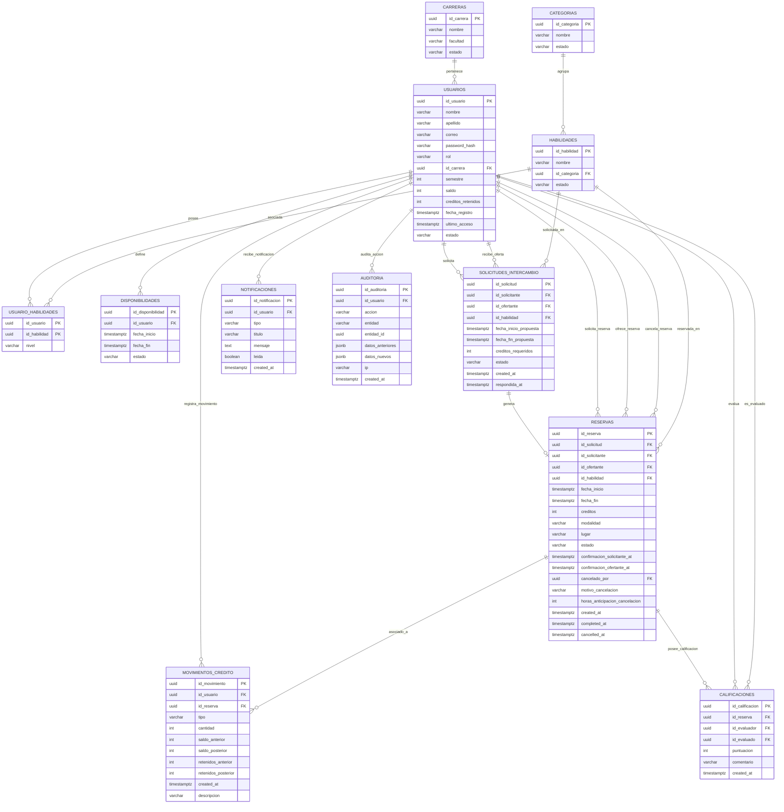

# Documentación de la Arquitectura de Base de Datos
## Sistema de Intercambio de Habilidades (v0.3.1 - Optimizado)

---

## 1. Resumen Ejecutivo y Decisiones de Diseño

El modelo original de la base de datos contaba con **18 tablas**. Tras una fase de refinamiento y optimización, el esquema se redujo a **12 tablas centrales**, logrando una arquitectura más limpia, escalable y con mejor rendimiento en consultas de backend.

### Principales Optimizaciónes Realizadas:
1. **Eliminación de `ROLES` y `USUARIO_ROLES`**: Se integró la columna `rol` (`varchar` / `enum`) directamente en `USUARIOS`. Dado que en un sistema de intercambio universitario la asignación de roles es simple (`Estudiante`, `Profesor`, `Administrador`), eliminar la relación $M:N$ simplifica significativamente la autenticación y autorización.
2. **Fusión de `CUENTAS_CREDITO` en `USUARIOS`**: Se eliminó la tabla independiente por tratarse de una relación estricta $1:1$. Las columnas `saldo` y `creditos_retenidos` ahora forman parte directa de `USUARIOS`, reduciendo la necesidad de hacer `JOIN` en cada transacción o consulta de perfil.
3. **Fusión de `CONFIRMACIONES` en `RESERVAS`**: En un intercambio bilateral entre dos partes (solicitante y ofertante), mantener una tabla externa para confirmaciones generaba sobrecosto. Se sustituyó por las columnas `confirmacion_solicitante_at` y `confirmacion_ofertante_at`.
4. **Fusión de `CANCELACIONES` en `RESERVAS`**: Se absorbió la información de cancelación (`cancelado_por`, `motivo_cancelacion`, `horas_anticipacion_cancelacion`) directamente dentro de `RESERVAS`.
5. **Eliminación de `TRANSFERENCIAS_CREDITO`**: Tabla redundante, ya que todo flujo monetario de créditos es auditado con precisión dentro de `MOVIMIENTOS_CREDITO`.

---

## 2. Diagrama Entidad-Relación (Mermaid)

Puedes copiar el siguiente bloque de código directamente en [Mermaid Live Editor](https://mermaid.live) para visualizar e interactuar con el diagrama.

---

## 3. Especificación Detallada de Tablas

### Módulo: Usuarios y Catálogos

#### 1. `CARRERAS`
Almacena las carreras universitarias de la institución.
* **`id_carrera`** (`uuid`, PK): Identificador único.
* **`nombre`** (`varchar`): Nombre de la carrera.
* **`facultad`** (`varchar`): Facultad a la que pertenece.
* **`estado`** (`varchar`): Estado del registro (`activo`, `inactivo`).

#### 2. `CATEGORIAS`
Categorías temáticas para clasificar las habilidades (ej. Programación, Idiomas, Música).
* **`id_categoria`** (`uuid`, PK): Identificador único.
* **`nombre`** (`varchar`, Unique): Nombre de la categoría.
* **`estado`** (`varchar`): Estado del registro.

#### 3. `USUARIOS`
Tabla central que almacena la información personal, credenciales, saldo y estado del usuario.
* **`id_usuario`** (`uuid`, PK): Identificador único.
* **`nombre`** / **`apellido`** (`varchar`): Datos personales.
* **`correo`** (`varchar`, Unique): Correo institucional.
* **`password_hash`** (`varchar`): Hash de la contraseña.
* **`rol`** (`varchar` / `enum`): Rol de acceso (`Estudiante`, `Profesor`, `Administrador`).
* **`id_carrera`** (`uuid`, FK): Referencia a `CARRERAS`.
* **`semestre`** (`int`): Semestre académico actual.
* **`saldo`** (`int`): Créditos disponibles del usuario.
* **`creditos_retenidos`** (`int`): Créditos retenidos temporalmente por reservas activas.
* **`fecha_registro`** / **`ultimo_acceso`** (`timestamptz`): Marcas de tiempo de auditoría de ingreso.
* **`estado`** (`varchar` / `enum`): Estado de la cuenta (`Activo`, `Inactivo`, `Suspendido`).

---

### Módulo: Habilidades y Disponibilidad

#### 4. `HABILIDADES`
Catálogo general de habilidades disponibles en la plataforma.
* **`id_habilidad`** (`uuid`, PK): Identificador único.
* **`nombre`** (`varchar`, Unique): Nombre de la habilidad.
* **`id_categoria`** (`uuid`, FK): Categoría a la que pertenece.
* **`estado`** (`varchar`): Estado de activación.

#### 5. `USUARIO_HABILIDADES`
Tabla pivote ($M:N$) que relaciona qué usuarios ofrecen o poseen qué habilidades.
* **`id_usuario`** (`uuid`, PK, FK): Usuario que posee la habilidad.
* **`id_habilidad`** (`uuid`, PK, FK): Habilidad poseída.
* **`nivel`** (`varchar` / `enum`): Dominio (`Basico`, `Intermedio`, `Avanzado`, `Experto`).

#### 6. `DISPONIBILIDADES`
Franjas horarias ofertadas por los usuarios para impartir tutorías/intercambios.
* **`id_disponibilidad`** (`uuid`, PK): Identificador único.
* **`id_usuario`** (`uuid`, FK): Usuario que publica la disponibilidad.
* **`fecha_inicio`** / **`fecha_fin`** (`timestamptz`): Rango temporal del bloque disponible.
* **`estado`** (`varchar`): Estado del bloque (`disponible`, `reservado`, `cancelado`).

---

### Módulo: Solicitudes y Reservas

#### 7. `SOLICITUDES_INTERCAMBIO`
Propuestas formales de intercambio enviadas de un usuario a otro.
* **`id_solicitud`** (`uuid`, PK): Identificador único.
* **`id_solicitante`** (`uuid`, FK): Usuario que pide la sesión.
* **`id_ofertante`** (`uuid`, FK): Usuario que impartirá la sesión.
* **`id_habilidad`** (`uuid`, FK): Habilidad solicitada.
* **`fecha_inicio_propuesta`** / **`fecha_fin_propuesta`** (`timestamptz`): Horario propuesto.
* **`creditos_requeridos`** (`int`): Cantidad de créditos en juego.
* **`estado`** (`varchar` / `enum`): `Solicitada`, `Aceptada`, `Rechazada`, `Cancelada`.

#### 8. `RESERVAS`
Sesiones confirmadas derivadas de una solicitud aceptada. Contiene la trazabilidad completa del ciclo de vida del intercambio.
* **`id_reserva`** (`uuid`, PK): Identificador único.
* **`id_solicitud`** (`uuid`, FK, Nullable): Solicitud de origen.
* **`id_solicitante`** / **`id_ofertante`** / **`id_habilidad`** (`uuid`, FK): Datos de la sesión.
* **`fecha_inicio`** / **`fecha_fin`** (`timestamptz`): Horario acordado final.
* **`creditos`** (`int`): Créditos transferidos o retenidos.
* **`modalidad`** (`varchar` / `enum`): `Presencial`, `Virtual`, `Hibrida`.
* **`lugar`** (`varchar`): Enlace de videollamada o ubicación física.
* **`estado`** (`varchar` / `enum`): `Confirmada`, `Completada`, `Cancelada`.
* **`confirmacion_solicitante_at`** / **`confirmacion_ofertante_at`** (`timestamptz`): Registro de verificación individual de asistencia.
* **`cancelado_por`** (`uuid`, FK, Nullable): Usuario que anuló la reserva.
* **`motivo_cancelacion`** (`varchar`): Justificación de la cancelación.
* **`horas_anticipacion_cancelacion`** (`int`): Horas entre la cancelación y el inicio previsto (usado para penalizaciones/reembolsos).

---

### Módulo: Créditos, Feedback y Sistema

#### 9. `MOVIMIENTOS_CREDITO`
Historial inmutable (libro mayor) de todas las transacciones de créditos.
* **`id_movimiento`** (`uuid`, PK): Identificador único.
* **`id_usuario`** (`uuid`, FK): Cuenta afectada.
* **`id_reserva`** (`uuid`, FK, Nullable): Reserva asociada a la transacción.
* **`tipo`** (`varchar` / `enum`): `BonoInicial`, `Recompensa`, `Penalizacion`, `Transferencia`, `Ajuste`, `Retencion`, `Liberacion`, `Consumo`.
* **`cantidad`** (`int`): Monto (+ o -).
* **`saldo_anterior`** / **`saldo_posterior`** (`int`): Snapshots del saldo general.
* **`retenidos_anterior`** / **`retenidos_posterior`** (`int`): Snapshots de créditos retenidos.

#### 10. `CALIFICACIONES`
Evaluaciones cruzadas publicadas al finalizar una reserva.
* **`id_calificacion`** (`uuid`, PK): Identificador único.
* **`id_reserva`** (`uuid`, FK): Reserva evaluada.
* **`id_evaluador`** (`uuid`, FK): Usuario que escribe la reseña.
* **`id_evaluado`** (`uuid`, FK): Usuario que recibe la reseña.
* **`puntuacion`** (`int`): Valor entre 1 y 5.
* **`comentario`** (`varchar`): Opinión descriptiva.
* **Restricción Única:** `(id_reserva, id_evaluador)` impidiendo duplicidad de calificaciones.

#### 11. `NOTIFICACIONES`
Centro de alertas push/in-app para los usuarios.
* **`id_notificacion`** (`uuid`, PK): Identificador único.
* **`id_usuario`** (`uuid`, FK): Destinatario.
* **`tipo`** (`varchar` / `enum`): `Solicitud`, `Reserva`, `Cancelacion`, `Calificacion`, `Sistema`.
* **`titulo`** / **`mensaje`** (`varchar` / `text`): Contenido.
* **`leida`** (`boolean`): Estado de lectura (Default `false`).

#### 12. `AUDITORIA`
Registro técnico de cambios en el sistema para trazabilidad y seguridad.
* **`id_auditoria`** (`uuid`, PK): Identificador único.
* **`id_usuario`** (`uuid`, FK, Nullable): Usuario que ejecutó la acción.
* **`accion`** (`varchar`): Operación realizada (`INSERT`, `UPDATE`, `DELETE`, `LOGIN`).
* **`entidad`** / **`entidad_id`** (`varchar` / `uuid`): Tabla y registro afectado.
* **`datos_anteriores`** / **`datos_nuevos`** (`jsonb`): Captura en JSON del estado antes y después del cambio.
* **`ip`** (`varchar`): Dirección IP del cliente.